# 故事线图表与原始数值

每幅图均有PNG与SVG，数值来自[统一CSV](../reports/storyline-chart-data.csv)。图示是本地适配结果，不是原论文图片。误差标记的含义在各图中单独注明。

## 内容信息有用，最佳接入方式依赖指标

主测试；点为三种子均值，短线为样本标准差，不是置信区间。横轴为局部范围。

[PNG](../figures/storyline/01-content.png) · [SVG](../figures/storyline/01-content.svg)

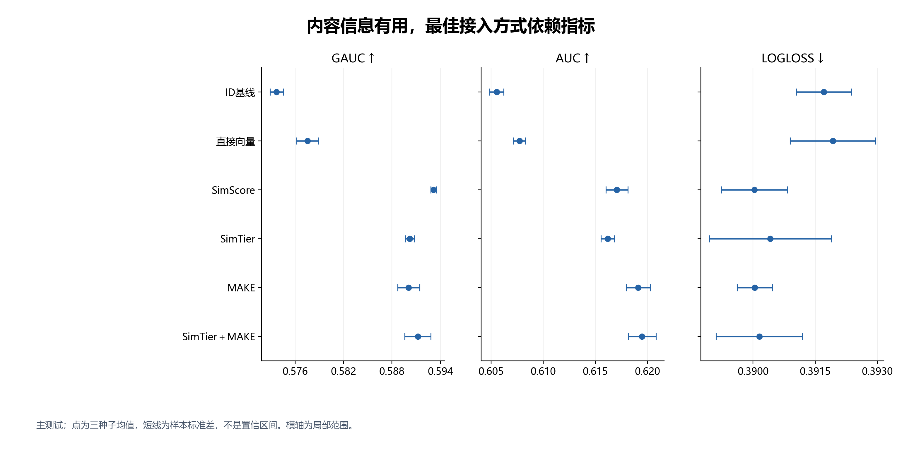

## MAKE：初始化与接入后更新必须分开比较

相同下游设置；预训练另有计算成本。主测试与追加测试分别留存，非新的盲测。

[PNG](../figures/storyline/02-make-strategy.png) · [SVG](../figures/storyline/02-make-strategy.svg)

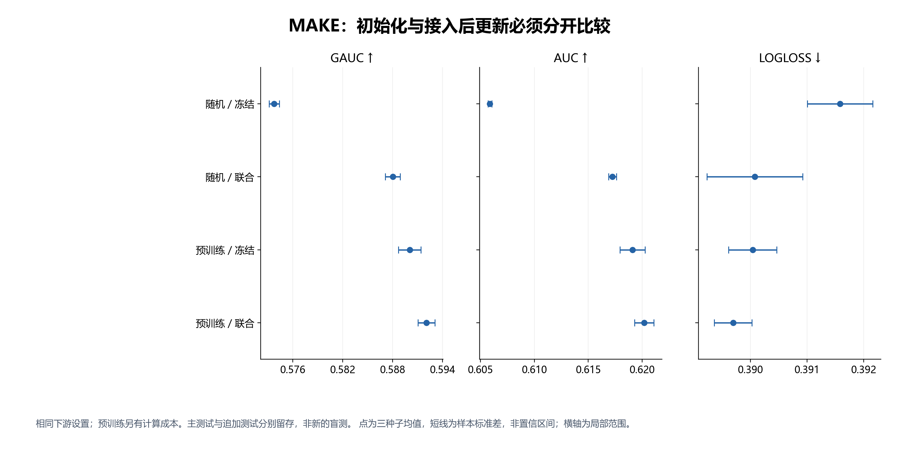

## 训练诊断：ID泛化退步，内容分支具有不同的学习曲线

验证过程诊断；两分支结构与batch不同，不能归因为ID embedding单一因素。训练损失为在线批次均值。

[PNG](../figures/storyline/03-training.png) · [SVG](../figures/storyline/03-training.svg)

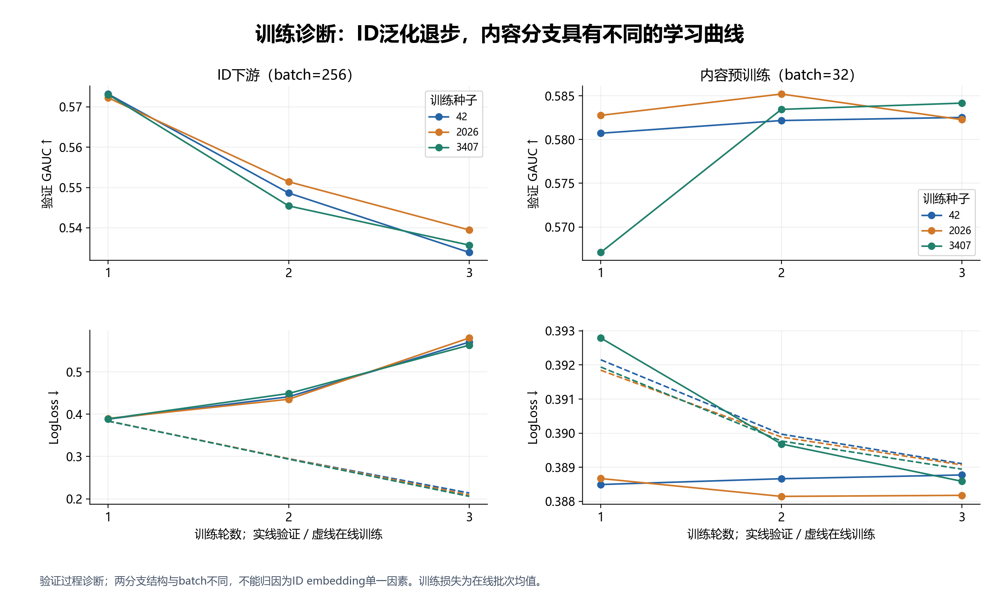

## 更多预训练并未稳定转化为更多下游收益

测试；P0参与联合训练，P1/P3/P5冻结接入。P0与正轮同时改变初始化及冻结策略，不是纯轮数效应。

[PNG](../figures/storyline/04-pretraining-epochs.png) · [SVG](../figures/storyline/04-pretraining-epochs.svg)

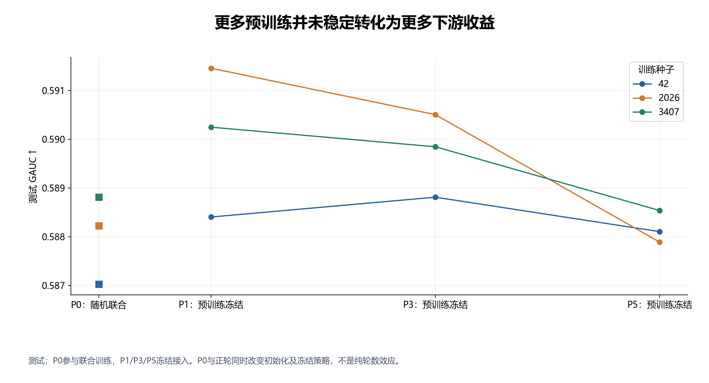

## 相同聚合结构下，内容检索优于本地ID与类目检索

主测试；L1000→K50，完整聚合结构相同。结果限定于当前表示及检索实现。

[PNG](../figures/storyline/05-retrieval.png) · [SVG](../figures/storyline/05-retrieval.svg)

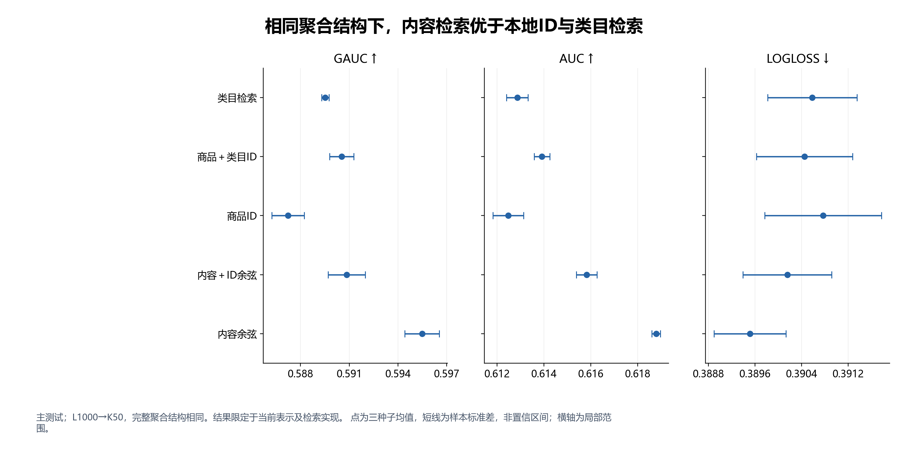

## 统计与语义注意力各有作用，叠加增量却不必明确

主测试；固定内容检索，L200→K50。“仅长历史统计”仍保留公共ID和短历史分支。

[PNG](../figures/storyline/06-aggregation.png) · [SVG](../figures/storyline/06-aggregation.svg)

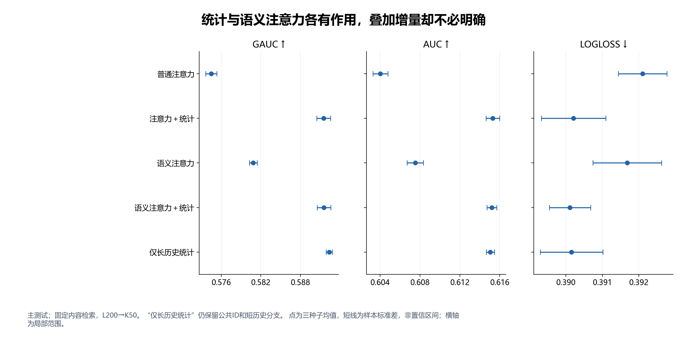

## 扩大候选历史有效，但最后一段增益具有种子差异

测试；所有长度固定K50。细线为各个种子，粗线为均值；不能由该测试曲线重新选择长度。

[PNG](../figures/storyline/07-history-length.png) · [SVG](../figures/storyline/07-history-length.svg)

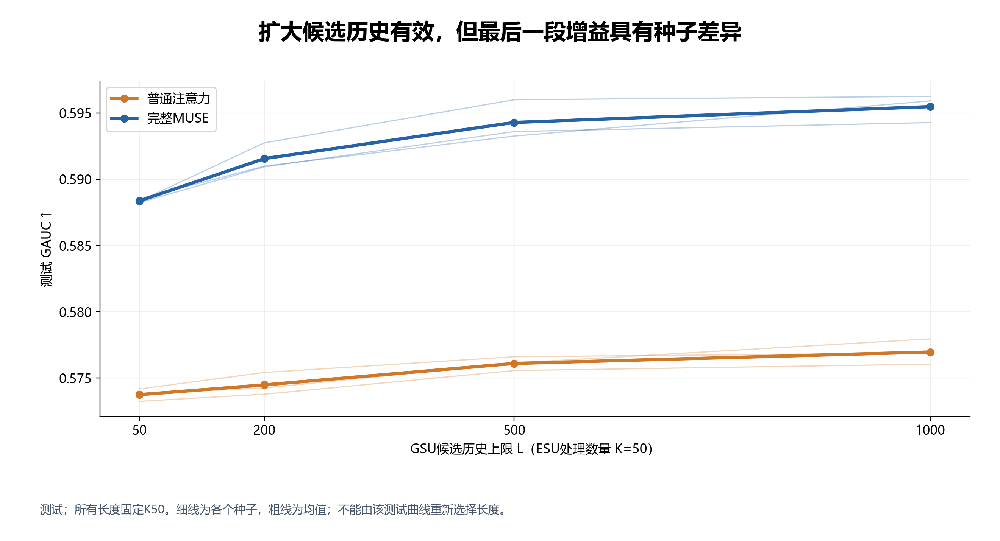

## 复杂检索没有稳定优势，必须展示失败种子

追加测试；差值＝学习式检索−内容余弦；单项95%用户bootstrap区间，未作多重校正。

[PNG](../figures/storyline/08-learned-retrieval.png) · [SVG](../figures/storyline/08-learned-retrieval.svg)

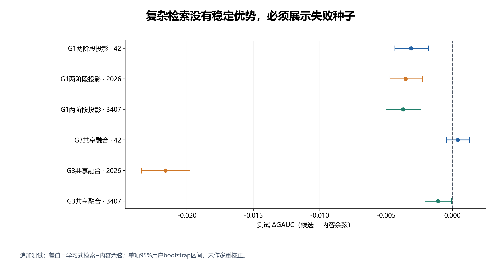

## 低频组收益更大：描述性证据，不是机制因果证明

测试事后分组；频次仅由训练目标曝光计算。点为三种子均值，无分组置信区间；频次0不等于新商品。

[PNG](../figures/storyline/09-frequency.png) · [SVG](../figures/storyline/09-frequency.svg)

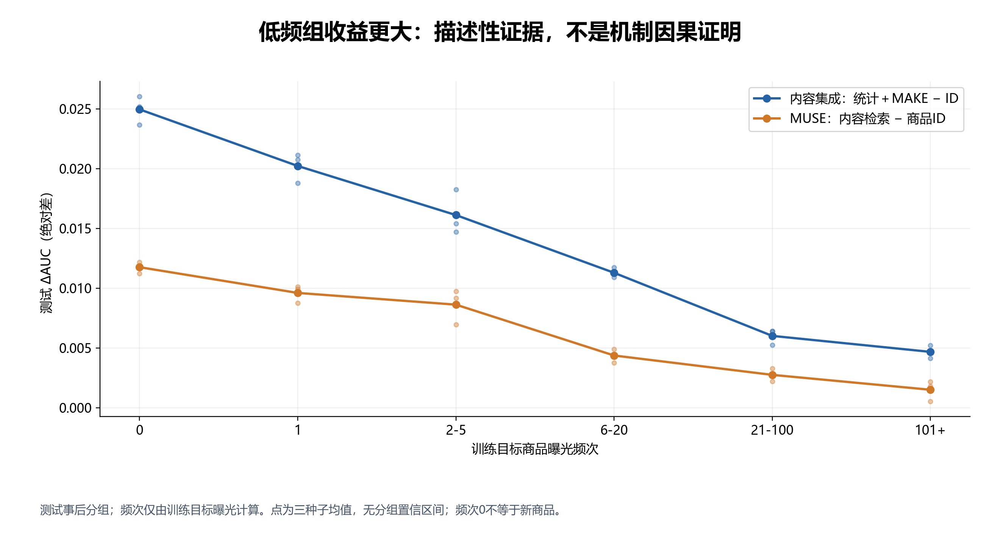

## G3异常种子的检索行为：内容排序方向出现反转

固定1024条验证位置的最终检查点诊断；与测试下降相容，但未证明训练因果或约束系数后的效果。

[PNG](../figures/storyline/10-g3-diagnostic.png) · [SVG](../figures/storyline/10-g3-diagnostic.svg)

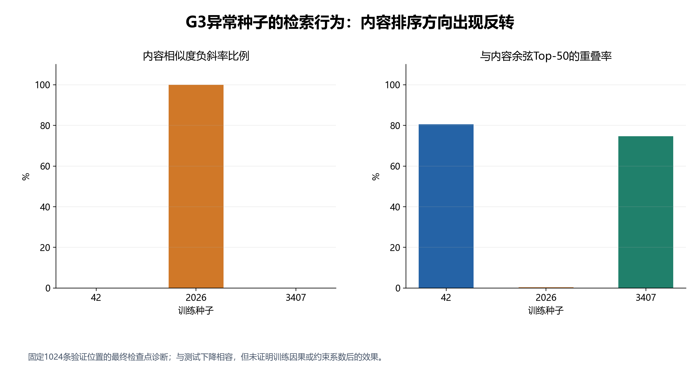

## 适配基线提供背景，不能替代受控机制比较

同一测试集；结构与历史预算不同。包含额外内容检索对照，不是原表数值复刻或等计算量排名。

[PNG](../figures/storyline/11-baselines.png) · [SVG](../figures/storyline/11-baselines.svg)

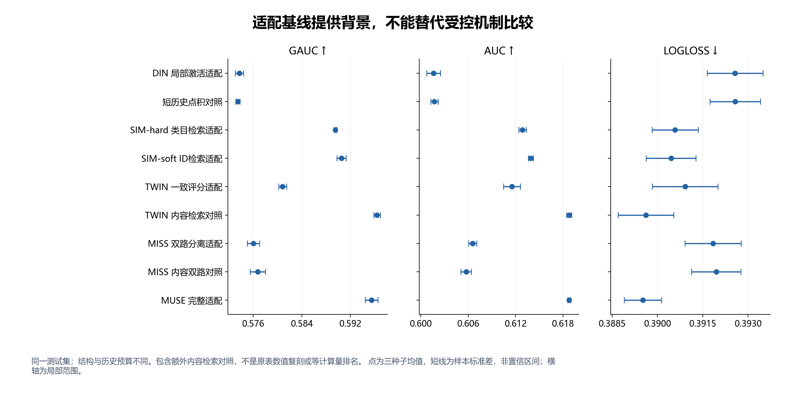

## 两个项目的联系：内容信息 → 历史选择 → 兴趣聚合

概念示意，不对应一条把所有模块串联起来的实测网络；原始图文编码器属于给定前提。

[PNG](../figures/storyline/12-framework.png) · [SVG](../figures/storyline/12-framework.svg)

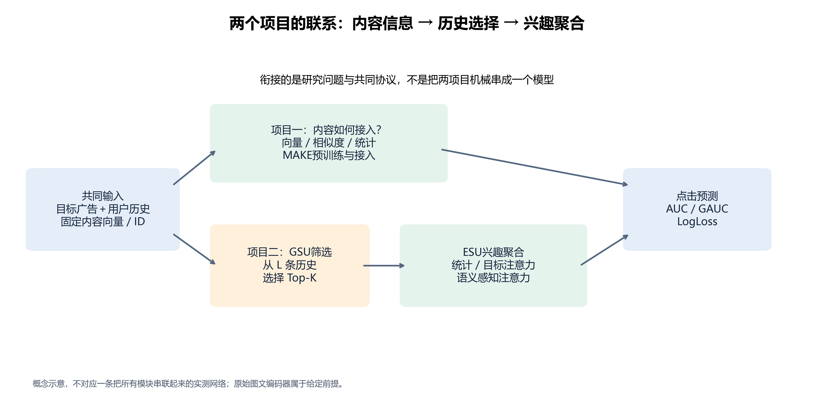
